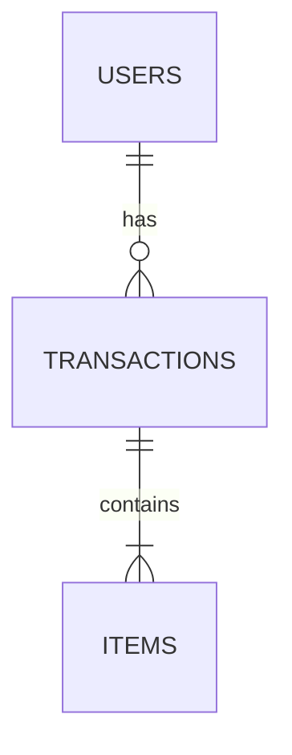

# Database Specification: [Nama Fitur]

## 1. Entity Relationship
Deskripsi hubungan antar tabel yang terlibat dalam fitur ini.



---

## 2. Table Schema

### Table: `table_name`

| Column | Type | Constraint | Description |
| :--- | :--- | :--- | :--- |
| `id` | UUID | PK, Not Null | Primary Key |
| `created_at` | TIMESTAMP | Default NOW() | |
| `updated_at` | TIMESTAMP | | |
| `deleted_at` | TIMESTAMP | Index | Soft Delete support |
| `user_id` | UUID | FK -> users.id | |
| `status` | VARCHAR(20) | | ENUM: pending, success |

**Indexes:**
- `idx_table_name_user_id` ON `table_name` (`user_id`)

---

## 3. Data Models (Golang Struct)

Representasi struct untuk digunakan dengan ORM (contoh: GORM).

```go
package domain

import (
	"time"
	"github.com/google/uuid"
	"gorm.io/gorm"
)

type TableName struct {
	ID        uuid.UUID      `gorm:"type:uuid;primary_key;default:uuid_generate_v4()"`
	UserID    uuid.UUID      `gorm:"type:uuid;not null;index"`
	Status    string         `gorm:"type:varchar(20)"`
	CreatedAt time.Time
	UpdatedAt time.Time
	DeletedAt gorm.DeletedAt `gorm:"index"`
}
```

---

## 4. Migration Strategy
Langkah-langkah migrasi (Up/Down).

**Up:**
1. Create table `table_name`.
2. Add foreign key constraint.
3. Add indexes.

**Down:**
1. Drop table `table_name`.
